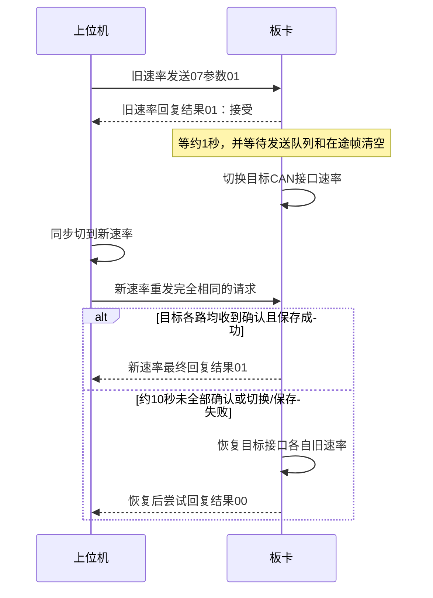

# 07参数设置与交互说明

适用：DW20261014、C 1.9.1-dev，2026-10-26启用配置包。按当前实现解释，不代表新增的切速率交互已经由协议制定者认可。

## 1. 本次启用范围

07是CAN参数设置指令，不是485寄存器写入。功能已有代码实现，本次打开开关并配置持久化路径，可执行程序与原1.9.1-dev相同。

```json
"parameters_enabled": true,
"can_rate_enabled": true,
"can_rate_both": false,
"runtime_settings": "/var/lib/zxjb14a-monitor-c/runtime-1.9.1-07.json",
"can_rate_state_file": "/var/lib/zxjb14a-monitor-c/can-rates-1.9.1-07"
```

parameters_enabled负责参数2～5；参数1由Linux切速率模块单独处理，需can_rate_enabled。can_rate_both=false只改接收请求的CAN接口；true改配置中的两路，且两路均须有外部确认才能提交。

不启用02主动上报、不增加08、不更换驱动。客户网关模式下07不按control_sources筛选来源，因此上位机需要自行管理操作权限。

## 2. 报文结构

使用经典CAN扩展数据帧，数据长度8。ID字段：类型5位、信源5位、信宿5位、通道6位、从站4位、序号4位。请求类型07，序号0；通常从站填0。

数据定义（字节从0起编号）：

|字节|含义|
|---|---|
|0|参数编号：01速率、02通道、03箱地址、04心跳周期、05状态周期|
|1～2|新参数值，大端：高字节在前|
|3|请求填00；响应01成功或接受，00失败|
|4～7|请求填00；响应保留原内容|

响应交换信源与信宿，通道、从站、序号沿用请求；不是01控制指令的序号1响应规则。不携带Modbus CRC。失败响应没有标准细分原因码。

以下示例：上位机地址6、原箱地址11，所有ID与数据均用十六进制表示。配置JSON地址11是十进制11。

## 3. 五个参数如何操作

|参数|示例请求ID|数据|含义|
|---|---|---|---|
|01|0732C000|01 01 F4 00 00 00 00 00|收到请求的CAN接口改为500K|
|02|0732C100|02 00 09 00 00 00 00 00|当前通道1改为通道9|
|03|0732C000|03 00 0C 00 00 00 00 00|箱地址11改为12|
|04|0732C000|04 07 D0 00 00 00 00 00|心跳周期2000ms|
|05|0732C000|05 07 D0 00 00 00 00 00|状态上报周期2000ms|

通道1改9成功响应：ID 07598100，数据02 00 09 01 00 00 00 00。
地址11改12成功响应仍用旧地址11回复：ID 07598000，数据03 00 0C 01 00 00 00 00。之后请求目的地址改为12，例如全局参数ID变为07330000。
周期设置成功响应：ID 07598000，字节3置01。

### 02：修改一个通道号

请求ID通道字段写旧通道，数据写新通道。只修改该通道对应的一个物理485口，不整体平移8路，不改变串口路径和物理口号。

值范围1～63，同板通道不得冲突；程序无法判断另一块板是否已占用目标通道。修改时不能有正在处理或排队的485事务；先停止上位机轮询并等待事务清空。

例如第2块板需要1～8改为9～16，必须执行8次并逐次检查，不是发送一次“1改9”就能完成。已接入第1块板且都配置1～8时，不可这样在线改：两块板都会匹配。应机箱外逐板配置，或隔离其他板。

### 03：修改箱地址

范围1～31，采集箱按协议使用11～17。修改整块板身份，需要无在途/排队485事务。不是只修改ID中的某个通道。

成功后用新地址查询及观察心跳。原请求再次发往旧地址通常无响应；不能因为重发没有应答就认为第一次失败。程序不会检测其他采集箱地址冲突。

### 04：修改心跳周期

单位ms，CAN两字节可表达100～65535ms。默认2000ms，建议保持协议要求的2秒。改变每轮心跳周期，不改变包间至少1ms的间隔。整块板生效。

### 05：修改状态周期

单位ms，最小100ms，且不能大于配置stale_ms；当前默认stale_ms=6000，所以当前模板可接受100～6000ms。CAN字段上限65535。

当前客户模式不执行02主动采集上报，因此设置成功只代表参数保存，不会开启02，也不改变03查询响应速度。

## 4. 01：CAN速率交互

支持50、100、125、250、500、1000 Kbit/s。数据值为kbit/s，例如250=00 FA、500=01 F4；不是填250000。只代表代码接受这些档位，不代表每档都已实板验收。



旧速率收到01只表示接受，不是最终成功。两次成功响应数据相同，没有单独的阶段字段，必须结合接收速率及交互阶段判断。

操作建议：先暂停01控制和03查询，再发一次切速率请求。收到接受后等切换窗口，在新速率下按短间隔重发完全相同的ID和8字节，争取在约10秒窗口内完成。收到新速率最终成功，再继续业务。首次发送队列约3秒仍不能排空会取消切换；出现忙碌、无效参数等也会失败。

can_rate_both=false时，确认必须从正在修改的那一路进入；另一条CAN不变。不要向两路同时发送想当然的单路修改操作。

can_rate_both=true时，从任一路发起会改配置内的两路；随后必须在两路新速率下分别发相同请求。只有一个有效对端不能完成双路确认；未确认会把两路恢复到各自原速率，不是统一恢复250K。

如果超时，应回到旧速率读取状态。回退失败不能保证软件自行修复，需本地检查接口。已确认且持久化成功后，未来普通断线不会自动恢复250K。

相同目标速率已生效时直接回复成功，不重新切换。保存文件按can_interfaces数组顺序记录两路bit/s值，不要调换接口顺序。

这是项目实现的确认/回退扩展，客户上位机需要配合；不能仅按表中一次请求、一次响应操作。

## 5. 多板共址必须知道的限制

同箱3块板共用地址11，07请求没有独立板卡序号字段。当前实现只有参数02按ID里的旧通道查本板端口；参数01、03、04、05不以通道来区分本板。

因此发给箱11的改地址、改周期、改CAN速率请求，可能由同箱3块板同时执行并回复；回复ID还可能相同。即使请求ID填通道9，也不能把这些全局参数限定为第2块板。

当前建议：逐板配置身份和通道后装箱。装箱后只有明确要修改全箱、且上位机能配合所有板确认的情况下，才执行全局参数。不要在正式控制过程中直接试切速率。广播目的地址0不用于07设置；各板可能返回失败，不能当成全箱设置。

02通道变更没有01控制业务那样的专门重复请求缓存：原通道改成功后，再向旧通道重发可能得到失败。不要把07统一套用“500ms发6次”的控制重发流程。跨CAN重复也有此问题。

若需多板在线独立维护，应先与协议方确认明确的板卡选中规则，再补实现；本次未擅自改协议。

## 6. 保存、重启和本地恢复

参数2～5：校验候选配置→写临时文件并同步→重命名提交→更新内存→回复成功。失败不提交新配置。

成功写入runtime-1.9.1-07.json，不回写monitor.site.json。重启时runtime覆盖主JSON的箱地址、通道和周期。速率单独保存在can-rates-1.9.1-07中。

更换箱位置时，不能只改主JSON却保留旧runtime覆盖。需停服务，备份并检查主JSON和两个状态文件，再决定保留哪些值。不要在运行中直接删除状态文件。

若明确要恢复到主JSON身份/周期与初始250K（会丢弃远程参数）：

```sh
systemctl stop zxjb14a-monitor-c
# 以下文件存在时才执行mv；备份名避免覆盖已有备份
mv /var/lib/zxjb14a-monitor-c/runtime-1.9.1-07.json /var/lib/zxjb14a-monitor-c/runtime-1.9.1-07.json.bak
mv /var/lib/zxjb14a-monitor-c/can-rates-1.9.1-07 /var/lib/zxjb14a-monitor-c/can-rates-1.9.1-07.bak
# 核对主JSON地址、8个通道和CAN配置，并让上位机恢复250K
systemctl start zxjb14a-monitor-c
```

## 7. 部署与检查

部署包：release/dw_20261014/c-1.9.1-dev-07-enabled-runtime-kit.tar.gz。
原1.9.1包保持不变；本包仍安装到相同1.9.1-dev目录，替换其配置。

```sh
cd /opt
tar -xzvf c-1.9.1-dev-07-enabled-runtime-kit.tar.gz
cd c-1.9.1-dev-07-enabled-runtime-kit
sha256sum -c SHA256SUMS
vi monitor.site.json
./zxjb14a_monitor_c --config monitor.site.json --check-config
sh install-outside.sh
systemctl enable --now zxjb14a-monitor-c
journalctl -u zxjb14a-monitor-c -n 40 -l --no-pager
/sbin/ip -s -details link show can0
/sbin/ip -s -details link show can1
```

运行配置：/opt/zxjb14a-monitor-c/1.9.1-dev/monitor.site.json。新板须已有驱动和hardware-prepare服务。

